# Results

Generated by `analysis/make_results_doc.py` from 357 simulation runs of 58 s of simulated time each. Nothing here is transcribed by hand.

**Column meanings.** *trigger median* is the time from a burst onset at a node to that node starting a CAP-to-extCFP conversion, with onsets that never triggered imputed at the 3.9 s observation horizon; *triggered* is the share of onsets that reached a trigger at all. A variant with no extension mechanism shows a dash. *burst drop ratio* and *burst PDR* cover the two beacon intervals the burst lasts. *control/pkt* is command frames per delivered packet; *idle extGTS* is the share of reserved extGTS slot-instances that carried no data — the price of reserving before the traffic arrives.

---

# Scenario A. Paper load: 21 packets/multi-superframe, bursts of 2 beacon intervals in a period of 8

The offered load of Reference C's dynamic scenario. At this rate the demand of the bursting half of the network is several times the whole CFP, so no protocol can absorb the burst; what differs is how fast each one reaches the capacity it can get, and the allocation failures that drive the reactive trigger are effectively permanent.

## Main comparison (n = 41 nodes)

| variant | onsets | trigger median (ms) | triggered | first extGTS median (ms) | burst drop ratio | burst PDR | run PDR | throughput (kbit/s) | control/pkt | idle extGTS |
|---|---:|---:|---:|---:|---:|---:|---:|---:|---:|---:|
| Legacy DSME | 420 | – | 0% | – | 0.455 | 0.104 | 0.235 | 52.0 | 1.81 | – |
| DSME + CAP reduction | 420 | – | 0% | – | 0.453 | 0.111 | 0.245 | 54.1 | 0.70 | – |
| TaCFPext (reactive, oracle demand) | 420 | 1480.5 | 59% | 3932.2 | 0.440 | 0.131 | 0.276 | 60.9 | 1.06 | 0.304 |
| TaCFPext (reactive, learned demand) | 420 | 1603.7 | 70% | 3932.2 | 0.469 | 0.102 | 0.238 | 52.5 | 1.28 | 0.304 |
| TaCFPext, trigger after 1 failure | 420 | 7.0 | 99% | 3932.2 | 0.393 | 0.195 | 0.338 | 74.7 | 0.81 | 0.295 |
| P-TaCFPext (this work) | 420 | 128.6 | 95% | 3932.2 | 0.416 | 0.163 | 0.295 | 65.2 | 1.98 | 0.316 |
| P-TaCFPext (oracle demand) | 420 | 128.4 | 95% | 3932.2 | 0.416 | 0.163 | 0.302 | 66.8 | 1.43 | 0.345 |

## Ablation: which component earns its place (n = 41 nodes)

| variant | onsets | trigger median (ms) | triggered | first extGTS median (ms) | burst drop ratio | burst PDR | run PDR | throughput (kbit/s) | control/pkt | idle extGTS |
|---|---:|---:|---:|---:|---:|---:|---:|---:|---:|---:|
| P-TaCFPext (this work) | 420 | 128.6 | 95% | 3932.2 | 0.416 | 0.163 | 0.295 | 65.2 | 1.98 | 0.316 |
| ablation: no trend term | 420 | 250.2 | 93% | 3932.2 | 0.415 | 0.165 | 0.295 | 65.2 | 1.90 | 0.329 |
| ablation: no onset detector | 420 | 251.0 | 85% | 3932.2 | 0.421 | 0.157 | 0.294 | 64.8 | 2.07 | 0.344 |
| ablation: no SAB capacity test | 420 | 2096.6 | 62% | 3932.2 | 0.448 | 0.123 | 0.254 | 56.1 | 2.25 | 0.362 |
| ablation: no early plain-GTS request | 420 | 128.6 | 95% | 3932.2 | 0.416 | 0.163 | 0.295 | 65.2 | 1.98 | 0.316 |

The *no early plain-GTS request* row is identical to the full protocol by construction, not by accident: when demand comes from the estimator, `dsme_demand_slots` already is the estimator's `g_req`, so the early-request branch in `dsme_gts_superframe_tick()` cannot fire. It only has an effect when demand is supplied by an oracle.

## Parameter sensitivity (n = 41 nodes)

| variant | onsets | trigger median (ms) | triggered | first extGTS median (ms) | burst drop ratio | burst PDR | run PDR | throughput (kbit/s) | control/pkt | idle extGTS |
|---|---:|---:|---:|---:|---:|---:|---:|---:|---:|---:|
| TaCFPext (reactive, oracle demand) | 420 | 1480.5 | 59% | 3932.2 | 0.440 | 0.131 | 0.276 | 60.9 | 1.06 | 0.304 |
| TaCFPext, trigger after 2 failures | 420 | 742.3 | 91% | 3932.2 | 0.421 | 0.162 | 0.300 | 66.3 | 0.93 | 0.315 |
| TaCFPext, trigger after 1 failure | 420 | 7.0 | 99% | 3932.2 | 0.393 | 0.195 | 0.338 | 74.7 | 0.81 | 0.295 |
| P-TaCFPext (this work) | 420 | 128.6 | 95% | 3932.2 | 0.416 | 0.163 | 0.295 | 65.2 | 1.98 | 0.316 |
| P-TaCFPext, horizon h = 1 superframe | 420 | 249.1 | 96% | 3932.2 | 0.414 | 0.168 | 0.305 | 67.4 | 1.79 | 0.328 |
| P-TaCFPext, horizon h = 8 superframes | 420 | 1970.4 | 85% | 3932.2 | 0.421 | 0.157 | 0.290 | 64.1 | 1.82 | 0.363 |
| P-TaCFPext, alpha = 0.2 | 420 | 249.3 | 95% | 3932.2 | 0.422 | 0.157 | 0.286 | 63.1 | 1.93 | 0.334 |
| P-TaCFPext, alpha = 0.6 | 420 | 2088.8 | 81% | 3932.2 | 0.432 | 0.144 | 0.271 | 59.8 | 1.95 | 0.382 |
| P-TaCFPext, persistence = 1 | 420 | 128.4 | 92% | 3932.2 | 0.411 | 0.176 | 0.310 | 68.4 | 1.77 | 0.345 |
| P-TaCFPext, persistence = 4 | 420 | 128.7 | 95% | 3932.2 | 0.415 | 0.167 | 0.302 | 66.6 | 1.88 | 0.323 |

## Scaling

| metric / variant | n=21 | n=41 | n=61 | n=81 | n=101 |
|---|---:|---:|---:|---:|---:|
| delivery ratio — Legacy DSME | 0.276 | 0.235 | 0.183 | 0.169 | 0.144 |
| delivery ratio — DSME + CAP reduction | 0.302 | 0.245 | 0.214 | 0.197 | 0.181 |
| delivery ratio — TaCFPext (reactive, oracle demand) | 0.386 | 0.276 | 0.240 | 0.203 | 0.188 |
| delivery ratio — P-TaCFPext (this work) | 0.450 | 0.295 | 0.241 | 0.201 | 0.182 |
| throughput (kbit/s) — Legacy DSME | 30.5 | 52.0 | 59.8 | 73.1 | 78.4 |
| throughput (kbit/s) — DSME + CAP reduction | 33.4 | 54.1 | 70.2 | 85.6 | 98.9 |
| throughput (kbit/s) — TaCFPext (reactive, oracle demand) | 42.6 | 60.9 | 78.6 | 88.1 | 102.5 |
| throughput (kbit/s) — P-TaCFPext (this work) | 49.7 | 65.2 | 79.0 | 87.3 | 99.3 |
| mean delay (ms) — Legacy DSME | 410.4 | 418.3 | 439.1 | 432.1 | 435.1 |
| mean delay (ms) — DSME + CAP reduction | 415.3 | 405.8 | 423.0 | 418.0 | 412.8 |
| mean delay (ms) — TaCFPext (reactive, oracle demand) | 415.7 | 407.6 | 404.3 | 392.2 | 394.2 |
| mean delay (ms) — P-TaCFPext (this work) | 418.8 | 414.5 | 401.7 | 386.8 | 385.0 |
| Jain fairness — Legacy DSME | 0.859 | 0.844 | 0.845 | 0.813 | 0.804 |
| Jain fairness — DSME + CAP reduction | 0.924 | 0.889 | 0.855 | 0.846 | 0.853 |
| Jain fairness — TaCFPext (reactive, oracle demand) | 0.871 | 0.911 | 0.889 | 0.867 | 0.888 |
| Jain fairness — P-TaCFPext (this work) | 0.908 | 0.891 | 0.854 | 0.836 | 0.829 |

| trigger latency median, ms (share of onsets triggered) | n=21 | n=41 | n=61 | n=81 | n=101 |
|---|---:|---:|---:|---:|---:|
| TaCFPext (reactive, oracle demand) | 1354.8 (70%) | 1480.5 (59%) | 1602.8 (56%) | 1604.8 (55%) | 1481.8 (60%) |
| P-TaCFPext (this work) | 128.3 (98%) | 128.6 (95%) | 130.2 (87%) | 495.9 (83%) | 2091.8 (83%) |

## Reproduction check against the published results

Reference C reports, for its dynamic scenario, that TaCFPext achieves 71.03 % and 20.50 % higher aggregate throughput than the legacy DSME and the DSME with CAP reduction, and 16.85–41.61 % shorter average delay. The same comparisons from this implementation, at the same offered load:

| n | throughput vs legacy | throughput vs CAP reduction | delay vs legacy | delay vs CAP reduction |
|---|---:|---:|---:|---:|
| 21 | +39.8% | +27.9% | -1.3% | -0.1% |
| 41 | +17.2% | +12.6% | +2.6% | -0.4% |
| 61 | +31.4% | +11.9% | +7.9% | +4.4% |
| 81 | +20.5% | +2.9% | +9.2% | +6.2% |
| 101 | +30.8% | +3.7% | +9.4% | +4.5% |

The ordering reproduces: TaCFPext beats both baselines on throughput at every network size. The magnitudes are smaller, and the delay figures much smaller, for two reasons that follow from the model rather than from the protocol. First, delay here is bounded by the one-multi-superframe packet deadline taken from Reference C's own description, so there is far less range for it to vary over than in a run with an unbounded queue. Second, this is a real stack: command frames contend for a real CAP, are lost to real collisions, and the CAPs that TaCFPext converts are then unavailable to carry the next negotiation — costs an analytical model does not pay.

## Figures

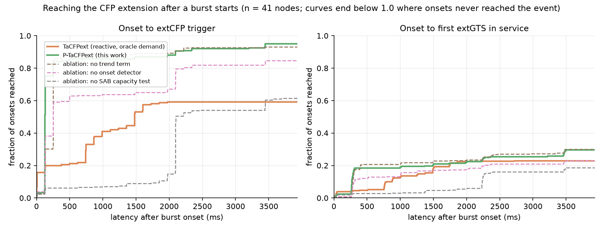

*Time from burst onset to trigger and to the first extGTS in service.*

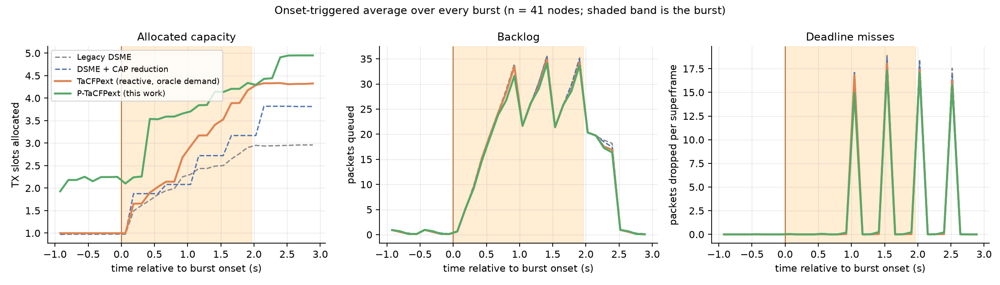

*Onset-triggered average of allocated capacity, backlog and deadline misses across every burst.*

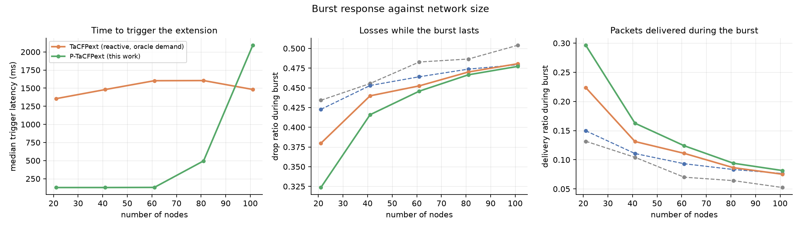

*Burst response against network size.*

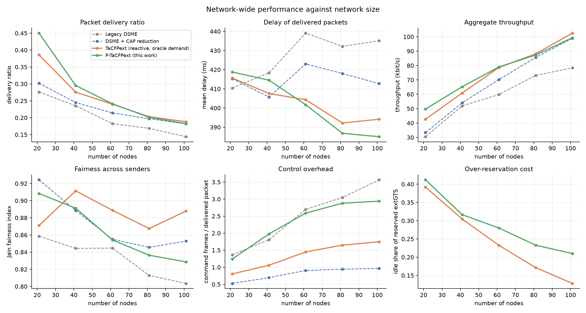

*Network-wide performance against network size.*

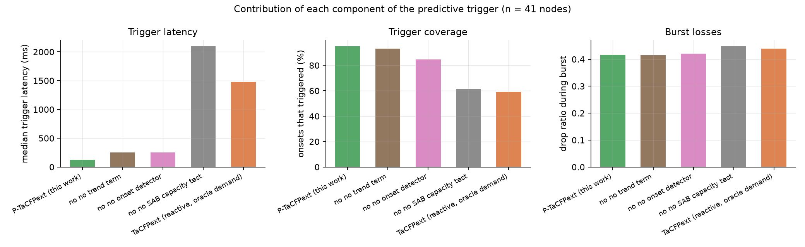

*Contribution of each component of the predictive trigger.*

---

# Scenario B. Moderate load: 6 packets/multi-superframe, bursts of 2 beacon intervals in a period of 8

A load at which the CFP plus a converted CAP can actually carry the burst, and at which allocation failures are transient rather than permanent. This is the regime that separates a forecast from a lower threshold.

## Main comparison (n = 21 nodes)

| variant | onsets | trigger median (ms) | triggered | first extGTS median (ms) | burst drop ratio | burst PDR | run PDR | throughput (kbit/s) | control/pkt | idle extGTS |
|---|---:|---:|---:|---:|---:|---:|---:|---:|---:|---:|
| Legacy DSME | 210 | – | 0% | – | 0.217 | 0.518 | 0.750 | 30.5 | 1.08 | – |
| DSME + CAP reduction | 210 | – | 0% | – | 0.172 | 0.605 | 0.792 | 32.2 | 0.37 | – |
| TaCFPext (reactive, oracle demand) | 210 | 3932.2 | 22% | 3932.2 | 0.202 | 0.546 | 0.766 | 31.2 | 0.90 | 0.370 |
| TaCFPext, trigger after 1 failure | 210 | 742.6 | 70% | 1125.5 | 0.128 | 0.695 | 0.874 | 35.5 | 0.52 | 0.347 |
| P-TaCFPext (this work) | 210 | 497.5 | 78% | 2228.2 | 0.082 | 0.756 | 0.884 | 36.0 | 1.44 | 0.522 |

## Main comparison (n = 41 nodes)

| variant | onsets | trigger median (ms) | triggered | first extGTS median (ms) | burst drop ratio | burst PDR | run PDR | throughput (kbit/s) | control/pkt | idle extGTS |
|---|---:|---:|---:|---:|---:|---:|---:|---:|---:|---:|
| Legacy DSME | 420 | – | 0% | – | 0.342 | 0.304 | 0.568 | 46.2 | 1.78 | – |
| DSME + CAP reduction | 420 | – | 0% | – | 0.304 | 0.369 | 0.622 | 50.6 | 0.58 | – |
| TaCFPext (reactive, oracle demand) | 420 | 3932.2 | 36% | 3932.2 | 0.293 | 0.389 | 0.645 | 52.5 | 1.14 | 0.299 |
| TaCFPext, trigger after 1 failure | 420 | 741.3 | 87% | 3932.2 | 0.232 | 0.499 | 0.730 | 59.4 | 0.75 | 0.304 |
| P-TaCFPext (this work) | 420 | 1727.2 | 60% | 3932.2 | 0.223 | 0.475 | 0.689 | 56.1 | 2.33 | 0.353 |

## Ablation: which component earns its place (n = 21 nodes)

| variant | onsets | trigger median (ms) | triggered | first extGTS median (ms) | burst drop ratio | burst PDR | run PDR | throughput (kbit/s) | control/pkt | idle extGTS |
|---|---:|---:|---:|---:|---:|---:|---:|---:|---:|---:|
| P-TaCFPext (this work) | 210 | 497.5 | 78% | 2228.2 | 0.082 | 0.756 | 0.884 | 36.0 | 1.44 | 0.522 |
| ablation: no trend term | 210 | 3932.2 | 48% | 3932.2 | 0.120 | 0.694 | 0.840 | 34.1 | 1.44 | 0.485 |
| ablation: no onset detector | 210 | 742.9 | 68% | 3932.2 | 0.105 | 0.728 | 0.864 | 35.1 | 1.50 | 0.492 |
| ablation: no SAB capacity test | 210 | 3932.2 | 37% | 3932.2 | 0.143 | 0.630 | 0.812 | 33.0 | 1.73 | 0.474 |

The *no early plain-GTS request* row is identical to the full protocol by construction, not by accident: when demand comes from the estimator, `dsme_demand_slots` already is the estimator's `g_req`, so the early-request branch in `dsme_gts_superframe_tick()` cannot fire. It only has an effect when demand is supplied by an oracle.

## Parameter sensitivity (n = 41 nodes)

| variant | onsets | trigger median (ms) | triggered | first extGTS median (ms) | burst drop ratio | burst PDR | run PDR | throughput (kbit/s) | control/pkt | idle extGTS |
|---|---:|---:|---:|---:|---:|---:|---:|---:|---:|---:|
| TaCFPext (reactive, oracle demand) | 420 | 3932.2 | 36% | 3932.2 | 0.293 | 0.389 | 0.645 | 52.5 | 1.14 | 0.299 |
| TaCFPext, trigger after 1 failure | 420 | 741.3 | 87% | 3932.2 | 0.232 | 0.499 | 0.730 | 59.4 | 0.75 | 0.304 |
| P-TaCFPext (this work) | 420 | 1727.2 | 60% | 3932.2 | 0.223 | 0.475 | 0.689 | 56.1 | 2.33 | 0.353 |

## Scaling

| metric / variant | n=21 | n=41 | n=61 |
|---|---:|---:|---:|
| delivery ratio — Legacy DSME | 0.750 | 0.568 | 0.505 |
| delivery ratio — DSME + CAP reduction | 0.792 | 0.622 | 0.557 |
| delivery ratio — TaCFPext (reactive, oracle demand) | 0.766 | 0.645 | 0.564 |
| delivery ratio — P-TaCFPext (this work) | 0.884 | 0.689 | 0.583 |
| throughput (kbit/s) — Legacy DSME | 30.5 | 46.2 | 61.0 |
| throughput (kbit/s) — DSME + CAP reduction | 32.2 | 50.6 | 67.2 |
| throughput (kbit/s) — TaCFPext (reactive, oracle demand) | 31.2 | 52.5 | 68.1 |
| throughput (kbit/s) — P-TaCFPext (this work) | 36.0 | 56.1 | 70.3 |
| mean delay (ms) — Legacy DSME | 275.7 | 318.1 | 337.7 |
| mean delay (ms) — DSME + CAP reduction | 247.1 | 299.1 | 329.3 |
| mean delay (ms) — TaCFPext (reactive, oracle demand) | 272.1 | 291.8 | 312.8 |
| mean delay (ms) — P-TaCFPext (this work) | 217.2 | 279.8 | 293.0 |
| Jain fairness — Legacy DSME | 0.959 | 0.945 | 0.906 |
| Jain fairness — DSME + CAP reduction | 0.972 | 0.951 | 0.935 |
| Jain fairness — TaCFPext (reactive, oracle demand) | 0.969 | 0.962 | 0.948 |
| Jain fairness — P-TaCFPext (this work) | 0.986 | 0.957 | 0.925 |

| trigger latency median, ms (share of onsets triggered) | n=21 | n=41 | n=61 |
|---|---:|---:|---:|
| TaCFPext (reactive, oracle demand) | 3932.2 (22%) | 3932.2 (36%) | 3932.2 (39%) |
| P-TaCFPext (this work) | 497.5 (78%) | 1727.2 (60%) | 2952.8 (57%) |

## Figures

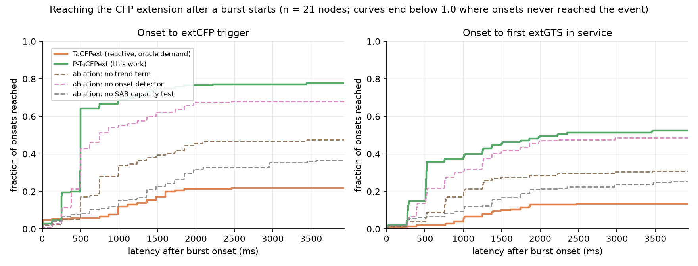

*Time from burst onset to trigger and to the first extGTS in service.*

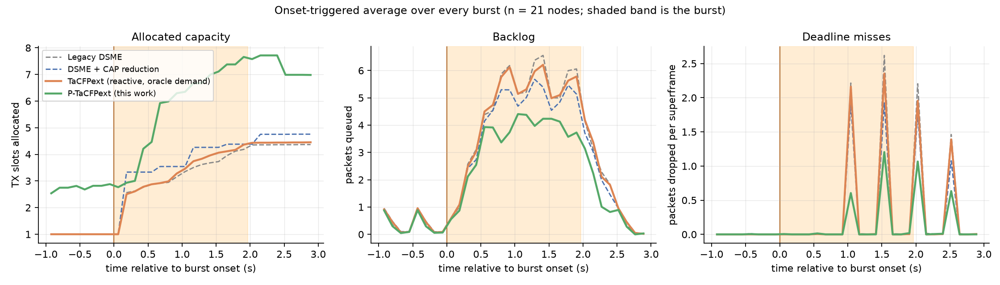

*Onset-triggered average of allocated capacity, backlog and deadline misses across every burst.*

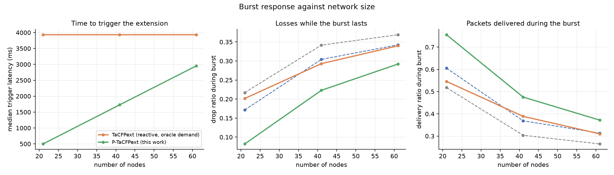

*Burst response against network size.*

*Network-wide performance against network size.*

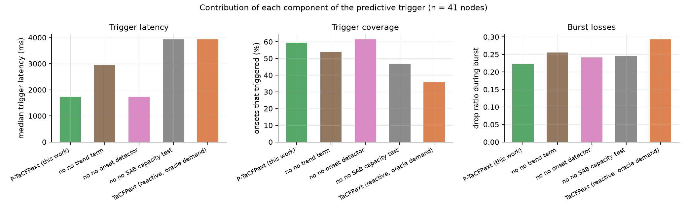

*Contribution of each component of the predictive trigger.*

---

# Scenario C. Short bursts: 21 packets/multi-superframe, bursts of 1 beacon interval in a period of 4

Bursts half as long and twice as frequent. The window in which a reactive trigger can still do any good is now about one beacon interval wide.

## Main comparison (n = 41 nodes)

| variant | onsets | trigger median (ms) | triggered | first extGTS median (ms) | burst drop ratio | burst PDR | run PDR | throughput (kbit/s) | control/pkt | idle extGTS |
|---|---:|---:|---:|---:|---:|---:|---:|---:|---:|---:|
| Legacy DSME | 840 | – | 0% | – | 0.726 | 0.249 | 0.288 | 64.7 | 2.15 | – |
| DSME + CAP reduction | 840 | – | 0% | – | 0.618 | 0.357 | 0.381 | 85.7 | 0.66 | – |
| TaCFPext (reactive, oracle demand) | 840 | 3932.2 | 48% | 3932.2 | 0.650 | 0.323 | 0.364 | 81.9 | 0.82 | 0.327 |
| TaCFPext, trigger after 1 failure | 840 | 6.1 | 92% | 3932.2 | 0.642 | 0.330 | 0.379 | 85.2 | 0.75 | 0.277 |
| P-TaCFPext (this work) | 840 | 128.9 | 98% | 3932.2 | 0.633 | 0.341 | 0.380 | 85.5 | 1.60 | 0.354 |

## Ablation: which component earns its place (n = 41 nodes)

| variant | onsets | trigger median (ms) | triggered | first extGTS median (ms) | burst drop ratio | burst PDR | run PDR | throughput (kbit/s) | control/pkt | idle extGTS |
|---|---:|---:|---:|---:|---:|---:|---:|---:|---:|---:|
| P-TaCFPext (this work) | 840 | 128.9 | 98% | 3932.2 | 0.633 | 0.341 | 0.380 | 85.5 | 1.60 | 0.354 |

The *no early plain-GTS request* row is identical to the full protocol by construction, not by accident: when demand comes from the estimator, `dsme_demand_slots` already is the estimator's `g_req`, so the early-request branch in `dsme_gts_superframe_tick()` cannot fire. It only has an effect when demand is supplied by an oracle.

## Parameter sensitivity (n = 41 nodes)

| variant | onsets | trigger median (ms) | triggered | first extGTS median (ms) | burst drop ratio | burst PDR | run PDR | throughput (kbit/s) | control/pkt | idle extGTS |
|---|---:|---:|---:|---:|---:|---:|---:|---:|---:|---:|
| TaCFPext (reactive, oracle demand) | 840 | 3932.2 | 48% | 3932.2 | 0.650 | 0.323 | 0.364 | 81.9 | 0.82 | 0.327 |
| TaCFPext, trigger after 1 failure | 840 | 6.1 | 92% | 3932.2 | 0.642 | 0.330 | 0.379 | 85.2 | 0.75 | 0.277 |
| P-TaCFPext (this work) | 840 | 128.9 | 98% | 3932.2 | 0.633 | 0.341 | 0.380 | 85.5 | 1.60 | 0.354 |

## Scaling

| metric / variant | n=41 |
|---|---:|
| delivery ratio — Legacy DSME | 0.288 |
| delivery ratio — DSME + CAP reduction | 0.381 |
| delivery ratio — TaCFPext (reactive, oracle demand) | 0.364 |
| delivery ratio — P-TaCFPext (this work) | 0.380 |
| throughput (kbit/s) — Legacy DSME | 64.7 |
| throughput (kbit/s) — DSME + CAP reduction | 85.7 |
| throughput (kbit/s) — TaCFPext (reactive, oracle demand) | 81.9 |
| throughput (kbit/s) — P-TaCFPext (this work) | 85.5 |
| mean delay (ms) — Legacy DSME | 364.9 |
| mean delay (ms) — DSME + CAP reduction | 320.0 |
| mean delay (ms) — TaCFPext (reactive, oracle demand) | 338.1 |
| mean delay (ms) — P-TaCFPext (this work) | 353.7 |
| Jain fairness — Legacy DSME | 0.572 |
| Jain fairness — DSME + CAP reduction | 0.625 |
| Jain fairness — TaCFPext (reactive, oracle demand) | 0.733 |
| Jain fairness — P-TaCFPext (this work) | 0.722 |

| trigger latency median, ms (share of onsets triggered) | n=41 |
|---|---:|
| TaCFPext (reactive, oracle demand) | 3932.2 (48%) |
| P-TaCFPext (this work) | 128.9 (98%) |

## Figures

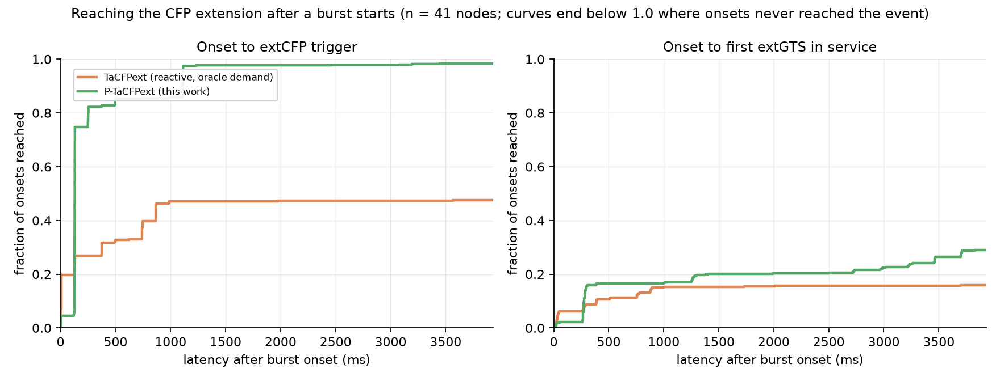

*Time from burst onset to trigger and to the first extGTS in service.*

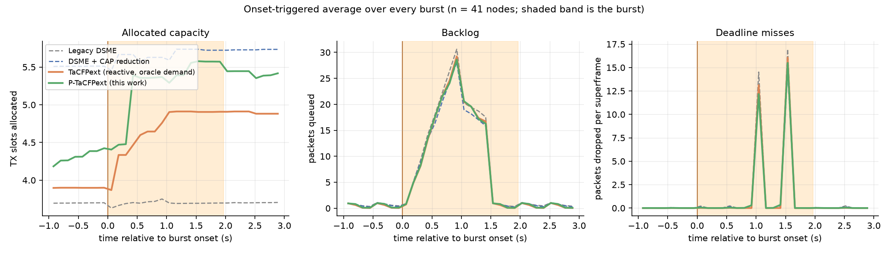

*Onset-triggered average of allocated capacity, backlog and deadline misses across every burst.*

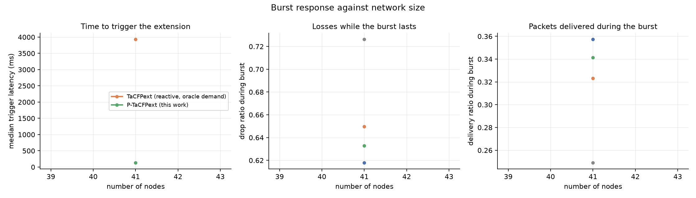

*Burst response against network size.*

*Network-wide performance against network size.*

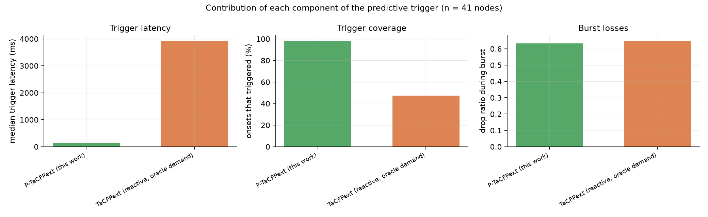

*Contribution of each component of the predictive trigger.*

